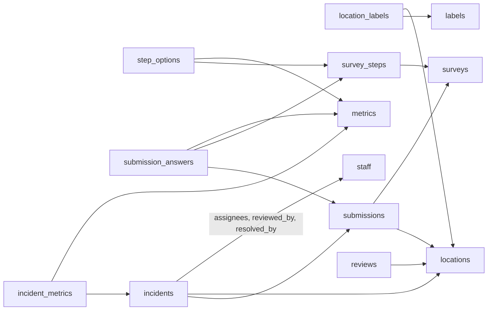

# Harlyy Feedback Pipeline – Data Dictionary & Runbook

Exported 23 Oct 2026 from the shared doc. The PDF in this folder is the same content with the join diagram as drawn in the doc.

## Overview

The Harlyy pipeline copies Eat'N'Go's customer feedback from Harlyy into Redshift every hour: survey submissions and their answers, incidents raised from them, and Google and Chowdeck reviews for Domino's, Cold Stone, Pinkberry and other brands in Nigeria and Kenya. Analysts query it in the `eatngo` database, schema `harlyy_feedback_analytics`.

| | |
| --- | --- |
| Freshness | Hourly; data is at most about an hour old (each run picks up the previous clock hour, Lagos time) |
| History | Submissions and incidents from Harlyy's first record (18 Mar 2026); reviews posted from 1 Jan 2026 |
| Matches Harlyy | Submissions, customers, ratings and Smile Score are calculated the way Harlyy calculates them (checked against Harlyy's own figures) |
| Code | GitHub `eatngoafrica/harlly-review-project`: `glue/` (scripts), `sql/redshift/` (tables, grants, views), `cloud_infra/` (Terraform) |
| AWS | Account 655103423742, region us-east-1; everything is defined in Terraform |
| Alerts | Failures are emailed (SNS topic `eatngo-harlyy-feedback-alerts`); successful runs are only logged |

## How it runs

Every hour at :05, the pipeline takes the records created or changed in the previous clock hour and merges them into Redshift. It is the same shape as the coldstone-web pipeline.

1. **Glue trigger** `eatngo-harlyy-feedback-hourly` starts the extract job (cron `5 * * * ? *`, UTC).
2. **Extract** (`eatngo-harlyy-feedback-extract`, `glue/harlyy_extract.py`): calls the Harlyy API for records whose `updatedAt` falls in the hour (with a 10-minute overlap), saves the raw responses to S3, builds the 13 tables, runs the data quality checks, then writes one Parquet file per table and a manifest.
3. **Hand-off:** the extract publishes a success message to SNS `eatngo-harlyy-feedback-events`; it lands in SQS `eatngo-harlyy-feedback-load-queue`, and the Lambda `eatngo-harlyy-feedback-load-dispatcher` starts the load. Messages that cannot be processed for about an hour go to the dead-letter queue `eatngo-harlyy-feedback-load-dlq`.
4. **Load** (`eatngo-harlyy-feedback-load`, `glue/harlyy_load.py`): COPYs the Parquet files into `harlyy_feedback_staging`, checks them, then MERGEs them into `harlyy_feedback_analytics` in one transaction. One load runs at a time.
5. **Alerts:** any failure is emailed through SNS `eatngo-harlyy-feedback-alerts`. Hours with no new or changed submissions, incidents or reviews skip the load, so Redshift is not woken for nothing.

Files in S3 bucket `eatngo-harlyy-feedback`:

| Path | Contents |
| --- | --- |
| `harlyy/raw/<entity>/<run>/<entity>.jsonl.gz` | Every API response, as received; kept even when a run fails. Written for every entity every run, even when Harlyy returned nothing (an empty file shows the hour was checked) |
| `harlyy/processed/<table>/<run>/<table>.parquet` | One file per table per run, only for tables with rows that run; what the load COPYs. A table with no new or changed records in an hour has no folder for that hour (lookups are refreshed whole, so they have one every hour) |
| `harlyy/manifests/<run>.json` | What a run wrote: files, row counts, columns and keys |
| `glue-scripts/` | The two Glue scripts, uploaded by Terraform |

`<run>` is `business_date=YYYY-MM-DD/hour=HH` for hourly runs, `business_date=YYYY-MM-DD` for a whole-day re-run and `full_history=YYYY-MM-DDTHH` for a backfill. Old versions of files are kept for 90 days.

## Data model

13 tables in `harlyy_feedback_analytics`: 5 hold feedback (facts), 8 describe it (lookups). Everything joins on Harlyy IDs. Tables with a key are upserted on it; child tables are replaced per parent whenever the parent changes.

| Table | Type | One row per | Key / parent | Rows (full history, 21 Oct 2026) | Distribution / sort |
| --- | --- | --- | --- | --- | --- |
| submissions | Fact | survey form, completed or abandoned | submission_id | 4,902 | DISTKEY submission_id, SORTKEY created_date |
| submission_answers | Fact (child) | answer; one per ticked option | parent submission_id | 31,768 | DISTKEY / SORTKEY submission_id |
| incidents | Fact | flagged problem (survey or media-document) | incident_id | 1,627 | EVEN, SORTKEY created_date |
| incident_metrics | Fact (child) | incident × topic | parent incident_id | 792 | DISTKEY / SORTKEY incident_id |
| reviews | Fact | Google / Chowdeck review, store details included | review_id | 3,980 | EVEN, SORTKEY review_date |
| locations | Lookup | store or online channel, labels as columns | location_id | 211 | ALL, SORTKEY location_id |
| location_labels | Lookup (child) | location × label | parent location_id | 993 | ALL, SORTKEY location_id |
| labels | Lookup | tag such as Region::West | label_id | 46 | ALL, SORTKEY label_id |
| surveys | Lookup | survey | survey_id | 7 | ALL, SORTKEY survey_id |
| survey_steps | Lookup | question or screen, archived ones included | step_id | 96 | ALL, SORTKEY step_id |
| step_options | Lookup (child) | answer option of a choice question | parent step_id | 204 | ALL, SORTKEY step_id |
| metrics | Lookup | answer option or topic name | metric_id | 162 | ALL, SORTKEY metric_id |
| staff | Lookup | Harlyy user (staff), for incident owners | staff_id | 67 | ALL, SORTKEY staff_id |

Join map (each arrow runs from the table holding an ID to the table it looks up):



submissions is the hub: answers and incidents hang off it, and reviews reach the store details through locations.

`harlyy_feedback_staging` holds identical working copies the load empties and refills every run; it is not for reporting.

## Table dictionary

Timestamps are UTC unless the name ends in `_local`; `_date` columns are the local day (Africa/Lagos for Nigeria and stores with no location, Africa/Nairobi for Kenya). Text columns are VARCHAR. Personal data (customer names and phone numbers) is marked PII.

### submissions

One row per survey form. Harlyy counts every form with at least one answered step, abandoned ones included.

| Column | Type | Description |
| --- | --- | --- |
| submission_id | text | Harlyy submission ID (`sbm_…`), key |
| survey_id | text | Survey answered → surveys |
| location_id | text | Store → locations; blank when the survey has no branch question or it was skipped |
| customer_id | text | Harlyy customer ID; blank if anonymous |
| staff_id | text | Staff member the survey link belongs to → staff |
| device_id | text | Phone or browser used |
| status | text | `completed` or `abandoned` |
| is_completed | boolean | status = completed |
| alert_sent | boolean | Harlyy sent an alert for this form |
| created_at / updated_at | timestamp | Form started / last changed |
| last_answer_at | timestamp | Time of the last answer |
| created_at_local, created_date, created_hour, weekday | timestamp, date, int, text | Start time in the store's local time zone |
| duration_ms, duration_min | bigint, decimal | updated_at − created_at; Harlyy's average time uses this |
| overall_rating | int 1–5 | Answer to the survey's main smileys question |
| rating_band | text | negative (1–2), neutral (3), positive (4–5) |
| has_comment | boolean | Any text answer (Harlyy's comment count) |
| comment_text | text | All text answers, joined with " \| " |
| has_contact | boolean | Name or phone given |
| customer_name, customer_phone | text | From the contact question (PII) |

### submission_answers

One row per answer. A multi-select question gives one row per ticked option. Screens viewed but not answered are left out.

| Column | Type | Description |
| --- | --- | --- |
| submission_id | text | → submissions (parent) |
| step_id, step_type | text | Question answered → survey_steps; type smileys, metrics, comment or contact |
| question | text | Wording shown; "What can we improve?" instead of "What did you like?" after a low rating |
| metric_id, metric_name | text | Option ticked → metrics (choice answers) |
| answer, answer_type | text | Readable value; type rating, choice, text or contact |
| submitted_at | timestamp | When this answer was given |
| rating | int 1–5 | Smileys answer |
| text | text | Free text |
| name, phone_number | text | Contact answer (PII) |
| linked_rating | int 1–5 | Rating on the step this question follows |
| metric_sentiment | text | `liked` (linked rating 4–5) or `improve` (1–3) for like / improve questions |
| smile_weight, smile_points | decimal | Smile Score helpers on smileys rows; Smile Score = FLOOR(100 × SUM(points) / SUM(weight)) |

### incidents

One row per flagged problem. `type = submission` comes from a survey (usually a low rating); `media-document` incidents come from other Harlyy sources and have no survey, location or rating.

| Column | Type | Description |
| --- | --- | --- |
| incident_id | text | Harlyy incident ID (`inc_…`), key |
| code | text | Reference shown in Harlyy, e.g. EAT-261020-0004 |
| type, is_survey_incident | text, boolean | `submission` or `media-document`; true for survey incidents (Harlyy's incident counts use these only) |
| status, is_open | text, boolean | open, in-review or resolved; is_open = not resolved |
| media_document_id, media_source_id | text | For media-document incidents; Harlyy has no API to look these up yet |
| submission_id, survey_id, location_id, customer_id, staff_id | text | What the incident came from |
| rating | int 1–5 | Rating that raised it |
| assignee_ids | text | Staff IDs, separated by `;` → staff |
| reviewed_by, resolved_by | text | Staff IDs → staff |
| created_at, updated_at, reviewed_at, resolved_at | timestamp | Lifecycle |
| created_date | date | Local day raised |
| hours_to_review, hours_to_resolve | decimal | From creation |

### incident_metrics

| Column | Type | Description |
| --- | --- | --- |
| incident_id | text | → incidents (parent) |
| metric_id, metric_name | text | Topic the incident is about, e.g. Customer Service |

### reviews

One row per review on Google, Chowdeck or any other platform Harlyy collects, posted on or after the review cut-off (1 Jan 2026). The store listing's details are copied onto each review.

| Column | Type | Description |
| --- | --- | --- |
| review_id | text | Harlyy review ID (`rev_…`), key |
| source | text | Platform: `google`, `chowdeck` |
| listing_id, listing_name | text | The store page the review was left on |
| brand | text | From the listing name (Domino's, Cold Stone Creamery, Pinkberry, or the name before " - ") |
| location_id | text | → locations; set for most Google listings, blank for Chowdeck (not linked in Harlyy) |
| country_code, city | text | From the listing; Chowdeck country is worked out from its map position |
| source_review_id, source_url | text | The review on the platform (a web link for Chowdeck, an internal reference for Google) |
| rating | int 1–5 | Star rating |
| title, content | text | Review text (often blank for rating-only reviews) |
| customer_name | text | Reviewer's display name |
| has_reply, reply_content, replied_at | boolean, text, timestamp | Your reply, if any |
| sentiment | text | Harlyy's reading: positive, negative, neutral or mixed |
| sentiment_positive / _negative / _neutral | decimal 0–1 | Harlyy's confidence scores |
| status | text | active |
| review_created_at, review_date | timestamp, date | When it was posted; local day |
| updated_at, synced_at, received_at | timestamp | Last change in Harlyy; last sync from the platform; received (usually blank) |
| alert_sent | boolean | Harlyy alerted on it (usually blank) |

### locations

One row per store or online channel. Harlyy labels ("Group::Value") are turned into columns, so most reports need no join to labels.

| Column | Type | Description |
| --- | --- | --- |
| location_id, location_name | text | Harlyy location ID (`loc_…`, key) and name, e.g. DP OWERRI |
| brand, country, state, city, region, regional_manager, order_type | text | From the location's labels, e.g. region Mainland 1, regional manager Kemi Ogunfowokan |
| other_labels | text | Labels with no group, separated by `;` |
| is_online | boolean | Online channel (has an Order Type label or the name starts "Online") |
| timezone, country_code | text | Africa/Lagos or Africa/Nairobi; NG or KE |
| address_line1, address_line2, city_address, postcode | text | Address as entered in Harlyy |
| latitude, longitude | decimal | Map position |
| google_place_id | text | The store's Google place |
| status, updated_at | text, timestamp | |

### location_labels

| Column | Type | Description |
| --- | --- | --- |
| location_id | text | → locations (parent) |
| label_id | text | → labels |

### labels

| Column | Type | Description |
| --- | --- | --- |
| label_id, label_name | text | Key; full name, e.g. Region::West |
| label_group, label_value | text | Region / West |
| type, description, status | text | |

### surveys

| Column | Type | Description |
| --- | --- | --- |
| survey_id, survey_name | text | Key; e.g. Delivery Survey - Dominos |
| brand, channel | text | From the name; channel Dine-In, Delivery or Website |
| survey_type, status | text | |
| step_count | int | Screens in the survey now (archived questions excluded) |
| created_at | timestamp | |

### survey_steps

One row per question or screen, including archived questions that older submissions still answer.

| Column | Type | Description |
| --- | --- | --- |
| step_id, survey_id | text | Key; → surveys |
| position | int | Order in the survey; blank if archived |
| step_type | text | smileys, metrics, comment, contact, location (branch picker), text-graphic (info screen) |
| question, negative_question, description | text | Wording; negative_question shows after a low rating |
| follow_up_step_id | text | The rating step a like / improve question depends on |
| is_multi_select | boolean | Several options can be ticked |
| status, is_archived | text, boolean | |
| is_overall_rating | boolean | The survey's main 1–5 rating (sets submissions.overall_rating) |

### step_options

| Column | Type | Description |
| --- | --- | --- |
| step_id | text | → survey_steps (parent) |
| metric_id, metric_name | text | Option offered → metrics |
| option_order | int | Order shown to the customer |

### metrics

| Column | Type | Description |
| --- | --- | --- |
| metric_id, metric_name | text | Key; option or topic, e.g. Fast, Food Quality (trailing spaces removed) |
| description, hide_from_analytics, status | text, boolean, text | |

### staff

Harlyy users. Emails and phone numbers are not loaded.

| Column | Type | Description |
| --- | --- | --- |
| staff_id | text | Key; used by incidents.assignee_ids, reviewed_by, resolved_by and submissions.staff_id |
| name, position, status | text | e.g. Regional Manager Mainland 1 |
| last_active_at | timestamp | |

## Reporting views and metric definitions

Use the views below for reporting; they apply Harlyy's rules so our figures match the Harlyy dashboard. Definitions confirmed with Harlyy support and by reconciling against Harlyy's analytics API.

| Metric | Harlyy's rule | How to calculate it here |
| --- | --- | --- |
| Submissions | Every form with at least one answered step, partial or abandoned included | `COUNT(*)` of submissions |
| Customers | Distinct customers per location per day, added up | `SUM(customers)` from vw_submission_analytics_daily |
| Comments | Forms with any text answer | `has_comment` |
| Ratings 1–5 | Every smileys rating, archived questions included | `step_type = 'smileys'` answers |
| Smile Score | Weighted ratings, normalised to 0–100, rounded down (formula below) | `FLOOR(100.0 * SUM(smile_points) / SUM(smile_weight))` |
| Incidents, resolved % | Survey incidents only | `is_survey_incident`; resolved / all |
| Average time | Simple mean of updatedAt − createdAt | `SUM(total_duration_ms) / SUM(submissions)` |
| 3rd-party review rating | All-time average per platform | `AVG(rating)` by `source` over all reviews |

**Smile Score.** Each rating has a value and a weight; a 1-star rating weighs about seven times a 4- or 5-star:

```
Smile Score = FLOOR( 100 × Σ count_r × weight_r × value_r  /  Σ count_r × weight_r )

            1★     2★     3★     4★     5★
value       0      0.25   0.50   0.75   1.00
weight      20     2      2      3      3
```

Harlyy described the method but not the weights; the weights were worked out from Harlyy's own scores and reproduce 757 of 782 of them exactly (Mar–Oct 2026). The other 25 come out 1 point higher than Harlyy, always where the exact score is a whole number (a rounding quirk on Harlyy's side). `submission_answers.smile_weight` and `smile_points` hold w and w × v, so no one has to remember the weights.

| View / query | What it gives | File |
| --- | --- | --- |
| `vw_submission_analytics_daily` | Harlyy's Submission Analytics per local day × survey × location, with brand, state, region, regional manager and channel; every column adds up, so roll up with SUM | `sql/redshift/03_reporting_views.sql` |
| `vw_review_actions` | Every review with store, region, regional manager, time to reply or time waiting (in minutes, and as text such as 3h 05m or 8d 19h) and an action priority (1 negative unreplied, 2 mixed unreplied, 3 positive unreplied, 4 replied); a quick-react query is at the bottom of the file | `sql/redshift/03_reporting_views.sql` |
| `vw_store_map` | Each Harlyy location (and each linked Chowdeck listing) with its store in the company master `public.pulse_store_master_map`: store_number, area, regional_bu and how it was matched (name match, manual, unmatched). Manual links live in the table `store_map_overrides`, set from the file; checks are at the bottom of the file | `sql/redshift/04_store_map.sql` |
| `vw_negative_feedback` | One row per negative item for manager alerts: surveys rated 1–2, and Google/Chowdeck reviews rated 1–2 or marked negative. It has a stable `alert_id`, `is_recent` (last 48 hours), customer contact, and the store_number, area and regional_bu to route on | `sql/redshift/05_alert_feed.sql` |
| Smilecard | Smile Score per location for a period, against the target (64) and the previous period, with the 1–5 star breakdown; lowest first | `sql/redshift/queries/smilecard.sql` |

Analysts creating their own views should create them late-binding (`WITH NO SCHEMA BINDING`) and schema-qualify every table, so pipeline table changes never require dropping their views.

## Data quality and guarantees

A run either loads completely or changes nothing, and re-running any run gives the same tables. Redshift does not enforce primary keys, so the pipeline checks them itself.

| Where | Check | If it fails |
| --- | --- | --- |
| Extract | Blank keys, duplicate rows, child rows without their parent, column names, values longer than the column | Processed files are not uploaded, nothing is loaded, failure emailed; raw files are kept for investigation |
| Extract | Submissions for unknown locations, reviews for unknown listings, answers to steps Harlyy no longer returns | Logged as warnings only |
| Load, before merging | Target tables still have the columns the files were written with; staged row counts equal the manifest; no blank keys or duplicates in staging | Nothing is merged, failure emailed |
| Load, merge | One transaction: upsert on the key, child rows replaced per parent | Any error rolls the whole run back |
| Load, after merging | No key from the run appears twice in the target | Failure emailed |

- **No duplicates:** records are keyed by Harlyy ID while being fetched, checked for duplicates twice and MERGEd on their key, so the 10-minute overlap between hours, re-runs and backfills never create duplicate rows.
- **One load at a time:** the load job allows one concurrent run; a second waits on the queue.
- **Changes to old records** (an incident resolved, a review replied to) are picked up because runs select by `updatedAt`, not creation date.
- **S3 is a log, not a table:** a record that changes appears in more than one run's files. Anyone reading S3 directly should take the latest version per ID.

## Operations runbook

**One-off runs:** in the AWS console, Glue → ETL jobs → `eatngo-harlyy-feedback-extract` → Run with parameters. The load starts by itself when the extract succeeds; the next scheduled run is hourly again.

| Parameter | Effect for that run |
| --- | --- |
| `--full-history true` | Everything up to the start of the current hour; reviews from the cut-off. Used for the initial backfill; about 10 minutes. Records changed during the hour it runs in are left to the hourly runs, so activate the schedule straight after, or follow with --date for today |
| `--hour 2026-10-21T09` | One hour (Lagos), e.g. a missed run |
| `--date 2026-10-20` | One whole day as a single run |
| `--reviews-from 2025` | Reviews from that year or date, this run only. To keep older reviews current, also lower `reviews_from` in Terraform |
| `--from-raw true` | Rebuild the Parquet from that run's saved raw files, without calling Harlyy |

**Re-running only a load:** `eatngo-harlyy-feedback-load` → Run with parameters → `--MANIFEST` = the manifest named in the failure email, e.g. `s3://eatngo-harlyy-feedback/harlyy/manifests/full_history=2026-10-22T08.json`.

**Pausing:** Glue → Triggers → `eatngo-harlyy-feedback-hourly` → Deactivate (Activate to resume), or set `schedule_enabled = false` in `cloud_infra/terraform.tfvars` and `terraform apply`. A `terraform apply` with `schedule_enabled = true` turns a console-paused trigger back on.

**Changing the pipeline:** change the code in GitHub, open a pull request (CI runs lint, tests, a DDL check and `terraform validate`), then after merge run `terraform apply` in `cloud_infra` (log in first: `aws sso login --profile eatngo`; in PowerShell quote `"-backend-config=backend.hcl"`). Table changes: regenerate `sql/redshift/01_tables.sql` with `python glue/harlyy_extract.py --print-ddl` and apply the change in Redshift before the next load.

| Alert or error | Cause | Fix |
| --- | --- | --- |
| Harlyy extract failed: HTTP 401 | Harlyy secret missing or changed | Update the SSM parameter `/harlyy-feedback/prod/harlyy-client-secret`, then re-run the hour |
| Harlyy extract failed: data quality problems | Something unexpected in Harlyy's data; the email lists it | Investigate with the raw files; fix the code or re-run once Harlyy is corrected |
| Harlyy load failed: Table definitions do not match | A column was added in code but not in Redshift | Apply the DDL change, re-run the load with `--MANIFEST` |
| Harlyy load failed: permission denied | Grants missing | Run `sql/redshift/02_grants.sql` |
| Glue job FAILED / TIMEOUT | Job crashed before it could report | Glue → the job → Runs → logs |
| Dead-letter queue alarm | A load could not start for about an hour | Check the load job's runs; re-run with the manifest from the message |
| `Token has expired` (local) | AWS SSO session ended | `aws sso login --profile eatngo` |

## Access and ownership

The pipeline runs without any one person, but in Redshift only the owner of a schema or table (or a superuser) can change or drop it. Whoever ran `01_tables.sql` owns them, so ownership should sit with a shared admin rather than a personal user.

| Piece | Who controls it | To make sure someone else can |
| --- | --- | --- |
| Redshift schemas and tables | Their owner (whoever ran 01_tables.sql) and superusers | Transfer ownership to the shared admin user (SQL below) and give named colleagues a role |
| Pipeline's database user | `IAMR:eatngo-harlyy-feedback-glue`: read/write data only, cannot change tables | Nothing; it is not tied to a person |
| Analyst access | Grants: read on `harlyy_feedback_analytics`; `CREATE` for analysts who build views | Run grants as the owner or a superuser |
| Glue jobs, schedule, queues, alerts, bucket | Terraform in `cloud_infra/`, state in S3 `eatngo-terraform-statefile` with locking | Anyone with the repo and an AWS SSO login with deploy permissions can run it |
| Harlyy API secret | SSM `/harlyy-feedback/prod/harlyy-client-secret` | AWS admins can update it |
| Failure alerts | Email subscriptions on `eatngo-harlyy-feedback-alerts` | Add a teammate or a shared mailbox to `alert_emails` |

Check who owns the tables, then hand them to the shared admin (run as the current owner or a superuser; replace `admin` with your admin user):

```sql
SELECT schemaname, tablename, tableowner
FROM pg_tables
WHERE schemaname IN ('harlyy_feedback_analytics', 'harlyy_feedback_staging');

ALTER SCHEMA harlyy_feedback_analytics OWNER TO admin;
ALTER SCHEMA harlyy_feedback_staging OWNER TO admin;
-- one per table, e.g.:
ALTER TABLE harlyy_feedback_analytics.submissions OWNER TO admin;
```

For named colleagues who should manage access day to day, a role keeps it to one grant per person:

```sql
CREATE ROLE harlyy_maintainer;
GRANT USAGE, CREATE ON SCHEMA harlyy_feedback_analytics TO ROLE harlyy_maintainer;
GRANT ALL ON ALL TABLES IN SCHEMA harlyy_feedback_analytics TO ROLE harlyy_maintainer;
GRANT ROLE harlyy_maintainer TO lawal_ayobola;   -- and any other maintainer
```

Current analyst access: `lawal_ayobola` has read access and can create views in `harlyy_feedback_analytics`.

## Known limitations

- **Chowdeck reviews have no region or regional manager:** Harlyy does not link Chowdeck listings to locations. Linking them in Harlyy fills these in on the next run.
- **Smile Score can be 1 point above Harlyy** on about 3% of scores, where the exact score is a whole number.
- **Kenyan days are Nairobi time;** Harlyy uses Lagos time for every store, so Kenyan daily figures can differ near midnight.
- **Customers summed across surveys** can count a customer twice if they answered two surveys at one store on the same day.
- **Records deleted in Harlyy stay in Redshift;** the API stops returning them (about 10 incidents a month were deleted in September). Harlyy's own incident count includes deleted ones, so ours is lower by those.
- **Reviews start 1 Jan 2026.** Older reviews need a one-off run with `--reviews-from` and a lower `reviews_from` in Terraform.
- **Media-document incidents** cannot be looked up yet; only their IDs are stored.
- **Personal data:** submissions and submission_answers hold customer names and phone numbers. Grant access accordingly.
